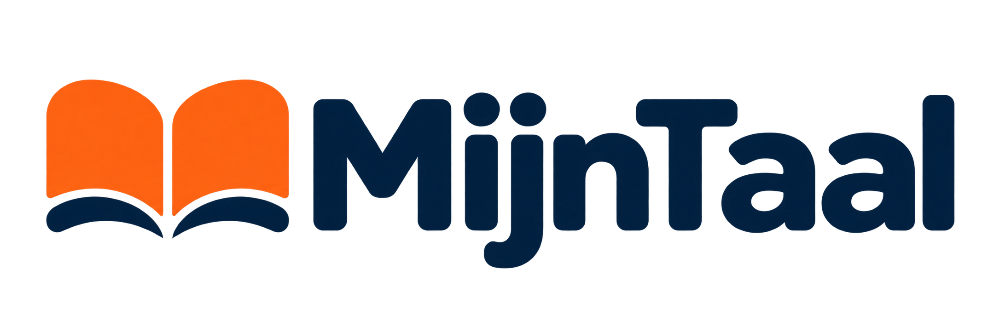

# MijnTaal

Your personal Dutch learning studio, with English as the reference language.



Collect Dutch words and texts, listen to recordings, and practise the material you choose. Connect your own instance to ChatGPT through its Sites-hosted MCP tools to save material directly from a conversation.

## Features

- A bundled Dutch ↔ English dictionary combining Kaikki learner details and WikDict translations, with source attribution.
- Azure-first phrase and text translations, with optional OpenAI fallback; AI grammar and contextual word explanations.
- English or Russian → Dutch phrase translation, with pronunciation and collection saving.
- Live Azure translation after a 500 ms typing pause, with dictionary and translator results in one card. Matching dictionary entries take priority; Search/Enter retains optional AI fallback.
- A personal collection with text editing, archive, import and export.
- Words practice and sentence practice with progress saved to your account.
- ElevenLabs pronunciation and connected text recordings with sentence highlighting.
- Four MCP tools: list, read, add and update material.

Learn how to choose a mode, use hints and understand review intervals in the [Practice guide](docs/PRACTICE.md).

## Requirements

Use Node.js 24 and pnpm 11.25.0. ChatGPT Sites hosts the server, database (D1), files (R2), and account authentication. Each installation is independent.

Dictionary browsing and collection/practice do not need provider keys. Plain translation uses your Azure Translator key and resource region when configured in Settings, falling back to your OpenAI account when available. Grammar analysis and AI explanations require OpenAI API access. Audio requires your own ElevenLabs key and an available voice in My Voices. Provider requests may incur charges; a chat subscription does not configure these provider accounts for this application. Do not paste keys into an AI conversation.

## Create your own instance

Download or clone the project, then follow [Sites setup](docs/SITES.md). Keep your instance private unless you deliberately choose another audience. Follow [MCP setup](docs/MCP.md) to connect it to your chat.

The source template intentionally has no Site project ID, collection, provider keys or voice ID. Sites supplies a new identity during provisioning. Never copy another installation's identity or database to create a new one.

## Local development

```sh
cp .openai/hosting.example.json .openai/hosting.json
pnpm install --frozen-lockfile
pnpm build
pnpm db:local
pnpm dev -- --hostname 127.0.0.1
```

Open the printed URL, normally http://127.0.0.1:5173. Use `/signin-with-chatgpt?return_to=/` for the loopback-only development identity. Local database and file state are separate from hosted storage. Real encrypted settings require a local secret configured from `.env.example`; the example contains no key. See [Sites setup](docs/SITES.md) for initialization and secret handling.

For subsequent Sites updates, `pnpm sites:stage` prepares an isolated deployment copy using your ignored hosting configuration. Publishing continues through the authenticated Sites workflow; see [deployment instructions](docs/SITES.md#deploy-changes-from-one-working-folder).

For a guided map of the application, configuration and deployment files, see [Project structure](docs/PROJECT_STRUCTURE.md). Coding agents should start with [AGENTS.md](AGENTS.md).

## Checks

```sh
pnpm check:public
pnpm format:check
pnpm typecheck
pnpm lint
pnpm test
pnpm build
```

Tests use in-memory/local fixtures and mocked provider responses. Passing them does not verify actual provider access, pronunciation, or hosted OAuth. CI never requires provider secrets. See [contributing](CONTRIBUTING.md) and [security](SECURITY.md).

## Dictionary updates

Dictionary preparation is separate from deployment. Run `pnpm dictionary:build --wikdict-dir /path/to/pinned-inputs` to verify pinned Kaikki/WikDict sources, build a local combined SQLite database and generate static bilingual JSON assets. Normal builds use the bundled files without downloading sources. See the [dictionary pipeline guide](docs/DICTIONARY.md).

## Data and backups

Collection → Export backup includes archived materials, translations and Words learning history/session state. Import uses preview and preserves conflicting existing edits. Audio binaries, provider keys, settings, browser caches and Sentences session state are not part of collection backups. Keep exports private. Audio can be regenerated with your own provider account.

The importer retains the legacy `ultimately-dutch-backup` format identifier for compatibility with existing backups. It is a file-format identifier, not an external service dependency.

## License

Application code is available under the [MIT License](LICENSE). Bundled dictionary data and vendored code retain their respective terms; see [third-party notices](THIRD_PARTY_NOTICES.md).
