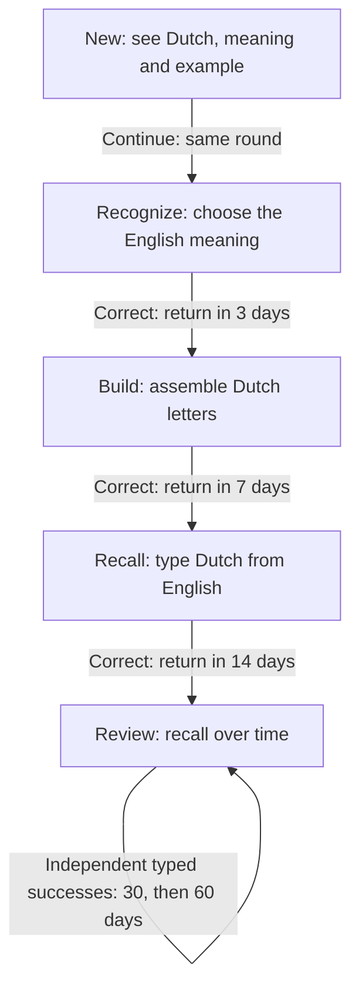

# Practice

Practice turns saved Dutch into language you can recognise and produce yourself. Choose an activity, attempt an answer, then use the feedback to decide what needs more work.

## Choose a mode

| Mode          | What it trains                               | Material                                                           | Scheduling                                 |
| ------------- | -------------------------------------------- | ------------------------------------------------------------------ | ------------------------------------------ |
| **Words**     | Meaning, spelling and recalling Dutch forms. | Saved entries with an English meaning, assigned to Words.          | Individual due dates and review intervals. |
| **Sentences** | Word order and producing complete phrases.   | Translated text sentences and saved phrases assigned to Sentences. | Rounds you start yourself; no due dates.   |

Use **Practice in → Words / Sentences / Off** on a saved entry. Off keeps it in your collection without practising it. Switching modes retains existing Words progress if the learning content is unchanged. Archived entries are excluded from new rounds.

A **mode** is the activity; an **answer format** is how you respond within it. Words uses Choices, Letters and Type. Sentences uses whole-word blocks or Typing. Words can also practise a short expression such as `dat valt mee` as one entry.

## Words

### The learning path

Open **Practice → Words**. Due entries come first; eligible new entries fill the remaining room, subject to your daily allowance.

In **Auto** answer mode, the usual path is:

This path assumes correct answers without hints. Intervals are gaps between visits: introduction and recognition on Day 0, then visits on Days 3, 10, 24, 54 and 114. Successful reviews remain at 60-day intervals once that limit is reached. Dates use calendar days rather than exact 24-hour countdowns.

**Introduction is not a test.** Continue records that you have met the entry without changing its due date or interval, recording a successful answer, or using an exercise slot. It counts toward the new-word allowance once. The first exercise follows two other card presentations, or sooner if fewer remain. If you finish before testing it, the entry stays available today.

**Recognition** normally offers four English meanings for a Dutch prompt. If suitable options are unavailable, recall the meaning, select **Show meaning**, then honestly choose **I recalled it** or **Not yet**.

**Letters** supplies shuffled characters, including spaces. **Type** asks you to produce the Dutch form yourself. Include a saved noun article: `de ochtend` requires `de` as well as `ochtend`.

**Already know** skips the introduction route and immediately tests English → Dutch. Pressing it alone changes no due date. An independent correct answer moves directly to Review in three days; an error moves to Recognize with a next-day review.

### Help, errors and intervals

On Dutch-answer cards, you can switch between **Choices**, **Letters** and **Type**. Choices falls back to Letters if four suitable answers are unavailable. At Recall/Review, correct answers without an explicit hint use these rules:

| Format  | Next interval                                                               | From a 7-day interval |
| ------- | --------------------------------------------------------------------------- | --------------------- |
| Type    | Next step in the ladder: 1, 3, 7, 14, 30, 60 days.                          | 14 days.              |
| Letters | About 40% longer, rounded; at least one extra day, capped at the next step. | 10 days.              |
| Choices | Keep the current interval.                                                  | 7 days.               |

The most helpful format exposed during the exercise counts. Switching from Choices back to Type does not erase the supplied answers. Earlier stages use the promotions shown in the diagram.

| Action or result                   | Effect                                                                                                 |
| ---------------------------------- | ------------------------------------------------------------------------------------------------------ |
| Correct with **Hint**              | Normally keep the stage; halve the interval, rounding down, with a minimum of 1 and maximum of 3 days. |
| Wrong / **I don't know**           | Review tomorrow; move to an easier stage where applicable.                                             |
| Correct after a miss in this round | Keep a one-day recovery interval.                                                                      |
| **Skip**                           | Use an exercise slot, keep the stage and review tomorrow.                                              |
| **My answer is also correct**      | Accept your self-assessment; review tomorrow without the normal success-based interval increase.       |

Hint reveals the first two characters. Listening **before an English → Dutch answer** also counts as help. Listening to a Dutch prompt or after checking does not. The recognition self-check's Show meaning is a special case: I recalled it is your reported result, not an automatic hinted penalty.

On an error, Build returns to Recognize; Recall/Review returns to Build; Recognize stays there. If **Repeat mistakes once later in the round** is enabled, one retry may follow at least three other exercise attempts, provided there is room. First exercises after introduction take priority. There is no immediate forced retry when the required spacing is unavailable.

The checker uses saved answers and available accepted Dutch alternatives. It ignores case, repeated spaces and supported surrounding punctuation; spelling, articles and word order still matter. Manual acceptance does not permanently add a new translation.

### Settings and progress

In **Settings → Words practice**:

- **Exercises per session:** default 10, range 1–30. Introductions are extra; retries use slots.
- **New words per day:** default 10, range 0–100, shared across rounds that day. Set 0 to practise only started entries.
- **Preferred answer mode:** Auto, Type, Letters or Choices.
- **Repeat mistakes once later in the round:** on by default.

Settings apply to new rounds. Rounds can be shorter when less material is eligible. An answered entry normally waits until its next due day, with the optional error retry as an exception.

The indicator shows **New 0/5 → Recognize 1/5 → Build 2/5 → Recall 3/5**, then **Review 4/5** or **Familiar 5/5**. Familiar means an entry is in review with an interval of at least seven days. These are learning labels, not a memory percentage or proficiency score; the successful path can skip 4/5. **Today**, **1d** and similar labels describe the due date; overdue entries show Today.

## Sentences

### Start a round

Open **Practice → Sentences**. Choose **All sources**, **All texts**, a particular text, or **Saved phrases**, then select a format:

- **Word blocks:** arrange supplied Dutch words in order. This targets sentence structure with vocabulary provided.
- **Typing:** produce the complete Dutch sentence from its English meaning, including vocabulary and spelling.

For **Every morning I cycle to work**, reconstruct:

> Elke ochtend fiets ik naar mijn werk.

Text sentences need both Dutch and English to be ready; add or prepare missing translations in **Texts**. Audio is optional. New rounds shuffle eligible sentences, remove duplicates and select up to the configured size. The default is 5; **Settings → Sentences practice** allows 1–30. You can switch Blocks/Typing on the current sentence.

### Check and learn from feedback

Attempt the sentence → **Check answer** → compare with the saved Dutch → **Next**.

| Control                            | Effect                                                                                       |
| ---------------------------------- | -------------------------------------------------------------------------------------------- |
| **Hint** / **Listen · hint**       | Reveal the first word or hear the sentence; a correct answer counts as With help.            |
| **Show answer** / **Skip**         | Record the sentence under To revisit. Skip advances immediately.                             |
| **My translation is also correct** | Accept a rejected typed translation as your self-assessment; counts as With help.            |
| **Finish**                         | End the round, retaining checked results; unattempted sentences are not automatically wrong. |

The checker ignores case, repeated whitespace, common sentence punctuation and curly versus straight apostrophes. It still expects the saved words in their saved order, so a valid paraphrase may need manual acceptance. It is not an open-ended grammar grader.

The summary groups results into **Correct**, **With help** and **To revisit**. **Review missed sentences** lets you inspect errors and skips. Listening after checking does not change the result.

Sentences currently has **no individual learning stages, review intervals or automatic error retries**. Another round can contain the same sentences, but does not specifically select only mistakes. You choose when to repeat it; its results do not change Words progress.

## Continue later

Words and Sentences keep separate rounds. **Resume session / Resume round** continues an available unfinished round; **Finish** ends it. Older rounds may retain earlier scheduling rules until finished.

If you see **sync pending**, the latest answers are saved on this device but still need to reach your account. Use **Retry sync** if offered and wait before relying on another device. Keep local answers and use recovery controls if another tab or an edited source causes a conflict.

Collection backups include supported Words history/session state, but not Sentences rounds or unsent browser-only actions. See [Data and backups](../README.md#data-and-backups).

## Why practise this way?

The aim is to move from seeing an answer to retrieving it yourself. Words adds spacing across days; Sentences applies recall to complete phrases and word order. Research supports the general benefits of [retrieval practice](https://pubmed.ncbi.nlm.nih.gov/16507066/) and [spaced learning](https://doi.org/10.1111/j.1467-9280.2008.02209.x). The exact MijnTaal intervals are application rules, not a validated personal memory model.
